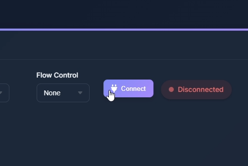

# Как подключить Smol SlimeVR трекеры к компьютеру

> [!NOTE]
> Это устройства для отслеживания движений всего тела, совместимые с системой SlimeVR. Это так называемые «Smol Slimes»: для подключения к ПК они используют протокол nRF вместо Wi-Fi. nRF схож с Bluetooth, но обеспечивает меньшую задержку сигнала. Чтобы узнать больше, ознакомьтесь с документацией SlimeVR, посвященной устройствам Smol Slimes.

## Подключение передатчика

Ваш передатчик должен быть подключён к USB 2.0 порту на задней панели материнской платы при помощи удлинителя.

## Управление передатчиком

> [!NOTE]
> Для взаимодействия с передатчиком используется COM-порт. Для подключения к COM-порту можно использовать любой доступный инструмент (PuTTY, NRF Connect - Serial Terminal, Web интерфейсы и тд.)

Перейдите на сайт [Веб-Последовательный терминал](https://webserialterminal.com "Link") и нажмите кнопку <b>Connect.</b>

Далее выберите передатчик в всплывающем окне.
Для самодельного передатчика соответствующее название <b>"SlimeNRF Receiver ProMicro (COMxxx)".</b>

После подключения вам будет доступен терминал. В поле ввода напишите <b>pair</b> и нажмите <b>Send.</b>

Включите трекер и нажмите кнопку 3 раза, чтобы перевести трекер в режим сопряжения.

<b>"New device registered"</b> - говорит об успешном подключении трекера. Проверьте, в SlimeVR Server должен появиться трекер.
